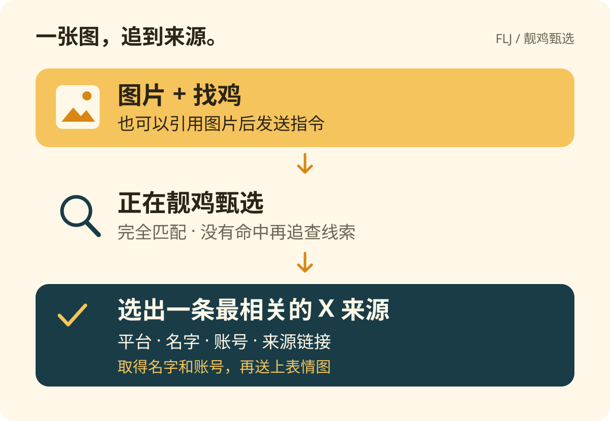

# 靓鸡甄选 · FLJ Finder

给 AstrBot 一张图，查找 **X / Twitter 的同图帖子和账号**。先做完全匹配，没有直接命中时，再从已有同图页面追查 X 线索。最终只返回最相关的一条 X 来源或可靠账号线索。



## 发图，找鸡

两种用法：发送 **图片 + `找鸡`**；或引用一张图片，再发送 **`找鸡`**。也支持 `/找鸡` 和 AstrBot 配置的唤醒前缀。多图消息取第一张，当前消息的图片优先于引用图片。

```text
你： [图片] 找鸡
Bot：正在靓鸡甄选
Bot：🎯 靓鸡甄选结果
平台：X
名字：来源接口提供的显示名
账号：@账号
来源：X 帖子链接

Bot： [成功表情图]
```

上面是消息格式示意，结果消息固定为标题、平台、名字、账号和来源五行。只取得账号或帖子线索时也使用相同格式；选出的 X 结果有名字和账号时会发送成功表情图。名字无法取得时显示“未提供”。

### 只返回哪一条

内部比较多个候选，最终最多展示一条：

1. 先选完全匹配或帖子配图比对通过的结果，具体帖子优先于账号主页。
2. 有明确引用关系且被引用帖配图也比对通过时，优先返回被引用帖。转发以接口返回的实际帖子作者和 ID 为准。
3. 同图结果中，优先账号与同图页面明确署名一致的候选；普通 `@提及` 只作较弱线索。
4. 同级优先采用 Google 完全匹配的原始排序。发布时间和热度不用于认定原创。

没有确认同图的结果、存在多个候选账号时，读取关注者数量，返回已取得数量的候选中关注者最多的一个。数量相同时按原有线索强度和顺序选择；数量无法取得时，再按明确署名、直接帖子链接、普通账号提及及不同来源网站的支持比较，证据相当时提示“暂时无法确定”。仅有关键词搜索命中的账号不算可靠线索。

<p></p>

## 怎么找

| 引擎 | 用途 | 配置 |
| --- | --- | --- |
| Google Lens | 只查询完全匹配 `exact_matches` | 默认直连；可填写 SerpApi Key 使用 API 通道 |
| 百度识图 | 补充同图页面；非 X 页面只用于提取线索 | 默认启用 |
| Ascii2D | 补充图片索引 | 默认启用，可能遇到 403 / 验证码 |
| SauceNAO | 补充有相似度的图片索引 | 可选；填写 API Key 后自动加入 |

各引擎并行检索，单个引擎失败不会丢弃其他结果。先返回有同图证据的 X 结果。没有直接命中 X，但取得了其他平台的同图页面时：

1. 从标题提取明确的 X 链接、`@handle` 或带分隔符的署名；必要时读取最多 3 个公开来源页面。
2. 使用已启用的 [astrbot_plugin_twitter](https://github.com/Ars1027/astrbot_plugin_twitter) 的 Nitter 地址搜索关键词；不可用或为空时，使用 SerpApi 搜索限定为 X/Twitter 域名的网页。
3. 复用 Twitter 插件读取帖子及图片，最多检查 3 条帖子；只有图片比对吻合，才升级为同图结果。已知账号还可检查其最近 3 条帖子。

### LLM 文字候选解析

没有直接命中 X 同图来源时，可用 AstrBot 已配置的聊天模型分析最多 6 个来源的 `title`、`source`、`link`，一次返回最多 3 个候选。默认开启，提供商 ID 留空时使用当前会话的模型，也可指定已有文本模型。

模型只接收来源文字，不接收图片、聊天历史或工具。候选必须带原文依据，程序重新检查账号字符、原文中的完整标识和明确的 X/Twitter 平台关系。优先检索明确的 X/Twitter 线索；网页追查和常规检索仍未找到同图来源时，也会通过推特插件查询平台未确定（`unknown`）的候选。查到同名账号仍只算待核实线索，不作为明确的来源署名。LLM 的置信度仅用于查询顺序，不用来证明账号或图片归属。

符合条件的候选最多调用 Twitter 插件查询 3 个账号，并核对返回的账号是否一致。查询成功表示账号存在；没有额外同图证据时仍为账号线索。一次最多增加一次 LLM 请求，限时 30 秒；模型不可用、超时或 JSON 无效时继续原有规则流程。

没有确认同图的 X 结果、但存在多个候选账号时，会读取候选的关注者数量，返回已取得数量的候选中关注者最多的一个。关注者数量相同时按原有线索强度和顺序选择一个；数量无法取得时保留原有判断。日志中的 `FLJ candidate followers` 会列出各候选及其关注者数量。关注者数量只用于选择候选，不作为同图证明。

### 浏览器与服务器的结果差异

需要查看模型提取了什么时，可开启 `log_title_candidates`。日志将以 `FLJ title candidates (unverified text)` 标记最多三个候选，包含账号字符串、原文依据及标题片段、平台判定和置信度；这些文字不代表已核实的人物身份或来源归属。完整链接和常见凭据字段会隐藏。此诊断开关默认关闭，排查完成后可关闭。

`v0.4.2` 起区分“没有同图结果”“已找到同图页面但未取得 X 来源”和“来源页面读取失败”。Google 返回同图页面后，第三方页面仍可能拒绝服务器访问（如 HTTP 403）；这不等于 Google 没有搜到。已取得的同图页面元数据保留在本次检索报告中，不直接当作人物身份或 X 账号归属证明。新增阶段日志记录数量及来源域名、读取状态，不记录原始标题或完整来源 URL。成功结果仍为五行格式。

Google 可能给服务器返回 HTTP 200 的 JavaScript 验证页，实际没有交付搜索结果。`v0.1.1` 起会明确提示验证失败，不能把这种情况判为图片没有出处。服务器能打开 Google 首页、位于海外，也可能遇到该验证。

在插件配置填写 `serpapi_api_key` 后，`google_lens` 使用 [SerpApi Google Lens API](https://serpapi.com/google-lens-api)。API 支持浏览器中的“完全匹配”，参数为 [`type=exact_matches`](https://serpapi.com/google-lens-exact-matches-api)。这是第三方检索服务，需要它自己的 Key；Google 模型 Key 或普通聊天模型 Key 不适用。可从 [SerpApi 控制台](https://serpapi.com/manage-api-key) 取得后在 AstrBot 面板填写，无需把 Key 发到聊天里。

API 通道上传后只查一次完全匹配，不回退到外观匹配；Lens 和 X 网页检索均设置 `safe=off`，对应浏览器关闭安全搜索。没有直接命中 X 时，来源追查最多追加两次关键词网页检索，**一次找图最多三次 SerpApi 搜索请求**，不自动重试；额度和计费以服务商账户为准。上传前会按 [Image API](https://serpapi.com/image-api) 的 500 KB 上限压缩图片，不需要额外图床。Key 留空时 Google Lens 使用直连通道，X 关键词追查仍可使用已配置的 Nitter。

## 安装

需要 **Python 3.12+、AstrBot 4.28+**。当前声明的平台为 **OneBot / aiocqhttp（QQ）**。

1. 在项目目录执行 `python scripts/build_zip.py`，生成 `dist/astrbot_plugin_flj_finder.zip`。
2. 在 AstrBot 管理面板的插件页选择“上传插件”，选择该 ZIP。
3. 在插件配置中填写允许的 QQ 群号或私聊 QQ 号，保存并重载后发送图片加 `找鸡`。

也可以将整个项目目录放入 AstrBot 的 `data/plugins/astrbot_plugin_flj_finder`。在 AstrBot 根目录、**AstrBot 使用的 Python 环境**执行下面的命令，然后在面板重载插件：

```bash
python -m pip install -r data/plugins/astrbot_plugin_flj_finder/requirements.txt
```

Docker 部署应将插件放入挂载的 `data/plugins`，依赖安装在 AstrBot 容器内。仅在正在运行的容器内安装的依赖不会随容器重建保留；重建后由插件管理器重新安装依赖，或在自己的镜像构建中安装 `requirements.txt`。

也可在 AstrBot 插件管理页使用仓库地址 `https://github.com/Ars1027/astrbot_plugin_flj_finder` 安装。根目录 `logo.png` 为插件列表头像，`CHANGELOG.md` 可供管理面板读取更新记录。

## 配置

在 AstrBot 插件配置页编辑，保存后重载生效。默认仅支持 OneBot / aiocqhttp QQ 平台。群聊只检查群号，私聊只检查发送者 QQ 号；未放行时静默跳过，不下载图片或消耗检索额度。两项白名单默认均为空，需要先配置。

例如允许群 `123456789`、允许 QQ `987654321` 私聊，分别填写：

```json
{
  "group_whitelist": ["123456789"],
  "private_qq_whitelist": ["987654321"]
}
```

| 配置 | 默认值 | 说明 |
| --- | --- | --- |
| `group_whitelist` | `[]` | 允许的 QQ 群号；空名单不允许群聊使用 |
| `private_qq_whitelist` | `[]` | 允许私聊使用的 QQ 号；不放行群聊 |
| `engines` | `google_lens`, `baidu`, `ascii2d` | 启用的识图引擎 |
| `proxy` | 空 | 识图请求的 HTTP(S) 代理；空为直连 |
| `serpapi_api_key` | 空 | Google Lens 的 SerpApi Key；填写后启用 API 通道 |
| `search_timeout` | `30` | 每个引擎的检索上限，单位秒 |
| `x_lookup_timeout` | `20` | 没有直接命中 X 时，来源追查的总上限，范围 5–30 秒 |
| `use_title_llm` | `true` | 没有直接 X 同图结果时调用模型解析来源文字 |
| `log_title_candidates` | `false` | 诊断时记录候选及原文片段，不自动查询平台未确定的别名 |
| `title_llm_provider_id` | 空 | 使用已有文本模型提供商 ID；留空跟随当前会话 |
| `saucenao_api_key` | 空 | 从 [SauceNAO](https://saucenao.com/user.php) 取得；配置后自动加入 |
| `cooldown_seconds` | `15` | 同一用户在同一会话的请求间隔 |
| `send_success_image` | `true` | 选出的 X 结果同时有名字和账号时发送 `assets/success.png` |

代理地址里的 `127.0.0.1` 指容器本身；请填写容器实际能访问的代理地址。代理与 API Key 不写入插件日志，配置仍由 AstrBot 保存在磁盘，面板遮罩不等于加密。

图片上限为 10 MB、3000 万像素。无需纠正方向且最长边不超过 1600 像素的静态 JPG、PNG、WebP 保留原始字节，避免重新编码影响同图检索；其他图片纠正方向、缩放并转为 JPEG，透明区域填白，动态图只取第一帧。API 上传超过 500 KB 时再按服务上限压缩。不保留图片检索缓存；命令冷却按会话和发送者隔离，最多同时处理两次请求。

## 验证与开发

在已经安装 AstrBot 的 Python 环境中安装测试依赖并执行：

```bash
python -m pip install -r requirements.txt pytest pytest-asyncio ruff
python -m pytest -q
python -m ruff check .
python -m ruff format --check .
```

测试使用真实 AstrBot 消息组件、过滤器及唤醒阶段，覆盖普通指令、引用图片（含 QQ 自动附带的 @）、多引擎解析与排序、部分失败、超时、冷却隔离和重载清理。网络与真实消息发送是测试中的边界，离线测试通过不代表第三方引擎始终可用。

回归用例还覆盖 HTTP 200 验证页、验证码、API 上传与完全匹配、只返回一条 X 来源、同级稳定排序、引用配图核验、线索强弱与账号歧义，以及失败、无结果或名字和账号不全时不发送成功表情。选出的 X 结果有名字和账号时，即使线索尚未确认同图也会发送成功表情。API 真机验证需要在插件配置中填写有效 Key。

单独测试服务器的真实识图网络，不发送 QQ 消息：

```bash
python scripts/smoke_search.py /path/to/test.jpg
python scripts/smoke_search.py /path/to/test.jpg --engines google_lens baidu --timeout 30
python scripts/smoke_search.py /path/to/test.jpg --config /AstrBot/data/config/astrbot_plugin_flj_finder_config.json
```

## 依赖与许可
代码及原创流程图采用 [MIT](LICENSE) 许可。插件头像和成功表情图来自需求方提供的图片，授权范围见 [素材说明](assets/README.md)。
